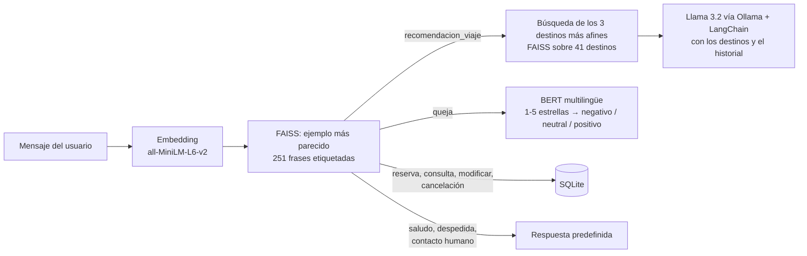

# Chatbot inteligente para agencia de viajes

Chatbot de atención al cliente para una agencia de viajes, hecho en Python con **IA ejecutada en local**
(sin APIs de pago):

- Entiende **qué quiere el usuario** (9 intenciones) mediante embeddings y búsqueda por similitud con FAISS.
- **Recomienda destinos** de un catálogo propio con un esquema RAG: busca los destinos más parecidos a la
  petición y un LLM local (**Llama 3.2 vía Ollama**) redacta la respuesta.
- **Analiza el sentimiento** de quejas y valoraciones con un modelo BERT multilingüe.
- **Gestiona reservas** (crear, consultar, modificar y cancelar) en una base de datos SQLite.

**Stack:** Python · Streamlit · Sentence Transformers · FAISS · Hugging Face Transformers · LangChain ·
Ollama (Llama 3.2) · SQLite · Pandas · NumPy

## Cómo funciona



| Componente | Archivo | Cómo está hecho |
|---|---|---|
| Intención | `modelos/intencion.py` | Las 251 frases de ejemplo de `intenciones2.csv` se convierten en vectores con `all-MiniLM-L6-v2` y se indexan en FAISS (`IndexFlatL2`). Cada mensaje recibe la intención de su ejemplo más cercano. |
| Recomendación (RAG) | `modelos/recomendacion_destino.py` | Los 41 destinos de `destinos2.csv` (país, tipo, clima, presupuesto, duración, público) se indexan igual. Los 3 más afines y los últimos mensajes de la conversación se pasan a Llama 3.2 con un `PromptTemplate` de LangChain que le pide recomendar solo los destinos del contexto que cumplan lo pedido (región, clima, presupuesto) y decir que no hay opciones si ninguno encaja. |
| Sentimiento | `modelos/sentimientos.py` | `nlptown/bert-base-multilingual-uncased-sentiment` devuelve de 1 a 5 estrellas: ≤ 2 es negativo, 3 neutral y ≥ 4 positivo, junto con la confianza del modelo. |
| Reservas | `modelos/reservas_db.py` | SQLite con identificador único por reserva. Las cancelaciones no borran la fila: cambian el estado a «cancelada». |
| Interfaz | `chatbot.py` | Chat de Streamlit con el historial en sesión y formularios para los datos de la reserva. |

**Intenciones (9):** saludo, despedida, recomendación de viaje, reserva, consulta de reserva,
modificación, cancelación, queja y contacto humano. Los datos son **sintéticos**, creados para el proyecto.

## Estructura

```text
chatbot_agencia_viajes/
├── chatbot.py                    # interfaz Streamlit y flujo de la conversación
├── datos_csv/
│   ├── intenciones2.csv          # 251 frases etiquetadas
│   └── destinos2.csv             # catálogo de 41 destinos
├── modelos/
│   ├── intencion.py
│   ├── recomendacion_destino.py
│   ├── sentimientos.py
│   └── reservas_db.py
└── requirements.txt
```

## Instalación y ejecución

Necesitas Python 3.10 o superior y [Ollama](https://ollama.com) instalado.

```bash
git clone https://github.com/marcforques/chatbot_agencia_viajes.git
cd chatbot_agencia_viajes
python -m venv .venv
```

Activa el entorno: en Windows `.venv\Scripts\activate`; en Mac/Linux `source .venv/bin/activate`.

```bash
pip install -r requirements.txt
ollama pull llama3.2
streamlit run chatbot.py
```

La primera ejecución descarga los modelos de Hugging Face (embeddings y BERT). Si Ollama no está abierto,
el chatbot sigue funcionando y avisa de que no puede generar recomendaciones.

## Limitaciones

- El clasificador de intención depende de las frases de ejemplo y aún no tiene una evaluación formal
  (precisión por intención).
- El catálogo de destinos es pequeño y está en un CSV.
- Los datos de la reserva se piden con formularios, no se extraen de la conversación.
- Las reservas son locales y no hay usuarios ni autenticación.

## Mejoras futuras

- Medir el clasificador con un conjunto de prueba aparte (precisión y matriz de confusión por intención).
- Ampliar las frases de intención y el catálogo, y añadir filtros (presupuesto, fechas).
- Extraer los datos de la reserva directamente del lenguaje natural con el LLM.
- Añadir una tabla de clientes y pasar de SQLite a PostgreSQL.

## Autor

Marc Forqués Isasi · [GitHub](https://github.com/marcforques) · [Portfolio](https://marcforquesisasi.vercel.app)
